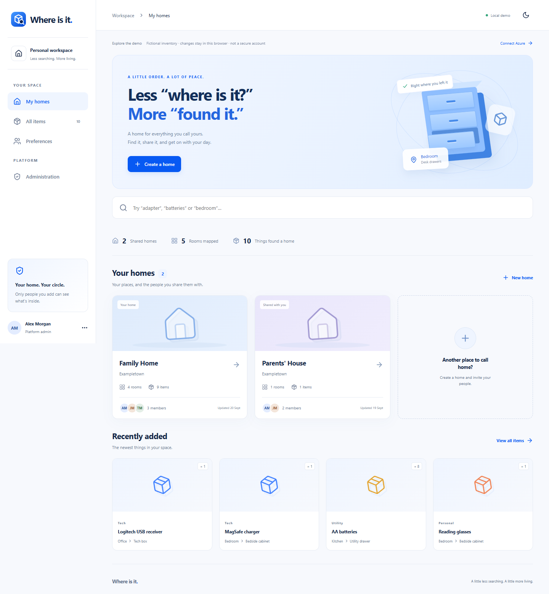

# Where Is It

Open source home inventory for finding what you own. Organise **homes → rooms → storage locations → items**, add photos, search everything, print QR labels, and share a home with approved people.



## Try the local demo

Install [Node.js 22](https://nodejs.org/) and run:

```sh
npm ci
npm run dev
```

Open the local address Vite prints (normally `http://localhost:5173`). The demo contains fictional data, stores changes in your browser, and has **no authentication**. Do not enter private inventory in it.

## Deploy your own private workspace

Follow the [beginner Azure deployment guide](docs/AZURE_SETUP.md). It asks you to choose the Microsoft account for the first platform administrator during setup. It covers subscription creation, service choices and costs, Cosmos DB, email invitations, GitHub Actions, and first sign in. Each deployment uses its owner's Azure resources; this repository contains no deployed service address or credentials.

Azure Static Web Apps **Free** hosts the UI and managed API. Azure Cosmos DB's opt-in free tier covers the first **1,000 RU/s and 25 GB** for one eligible account per subscription. Use a subscription with no free tier Cosmos account, or create a new eligible subscription. Invitation email through Azure Communication Services is **usage billed**; Azure Free is not a spending cap. See the [cost table](docs/AZURE_SETUP.md#services-and-costs).

## Features

| Task | Guide |
| --- | --- |
| Create a home, bedroom, drawer, and item | [Inventory walkthrough](docs/USER_GUIDE.md#build-your-first-inventory) |
| Search, edit, move, delete, add a photo | [Manage items](docs/USER_GUIDE.md#manage-items) |
| Print and scan QR labels | [QR labels](docs/USER_GUIDE.md#qr-labels) |
| Invite users and add home members | [Sharing and administration](docs/USER_GUIDE.md#sharing-and-administration) |
| View activity, export JSON, switch theme | [Activity and preferences](docs/USER_GUIDE.md#activity-export-and-preferences) |

The [user guide](docs/USER_GUIDE.md) includes UI screenshots. The [docs index](docs/README.md) links setup, use, architecture, and security.

## Security model and limits

Microsoft sign in is handled by Azure Static Web Apps. The API checks an active approved account for every request and home membership for inventory and photos. Platform administrators cannot browse a home unless its owner adds them. The managed API must stay behind Static Web Apps; a standalone public Function would make its identity header forgeable. See [security](SECURITY.md) and [architecture](docs/ARCHITECTURE.md).

This small household app stores one home inventory per Cosmos document. Photos are separate compressed documents. Deletions cannot be restored in the UI; exported JSON omits photos. The owner sees the newest 500 home activity entries in the UI. The API limits requests per Microsoft identity and invitation attempts per administrator; it has no network-wide IP limit, recovery screen, or security certification.

## Local checks

```sh
npm ci
npm --prefix api ci
npm test
npm run test:invitations
npm run build
npm --prefix api run build
npx playwright install chromium
npm run test:e2e
```

## Contributing

Issues and pull requests are welcome. Start with a small, reproducible change, run the checks above, and explain what changed and how you tested it in your pull request. Keep demo records fictional and leave Azure credentials, household data, and deployment addresses out of commits and screenshots. Read [CONTRIBUTING.md](CONTRIBUTING.md) for the development workflow.

Report security concerns privately using [SECURITY.md](SECURITY.md), rather than opening a public issue. This project is licensed under [MIT](LICENSE).
