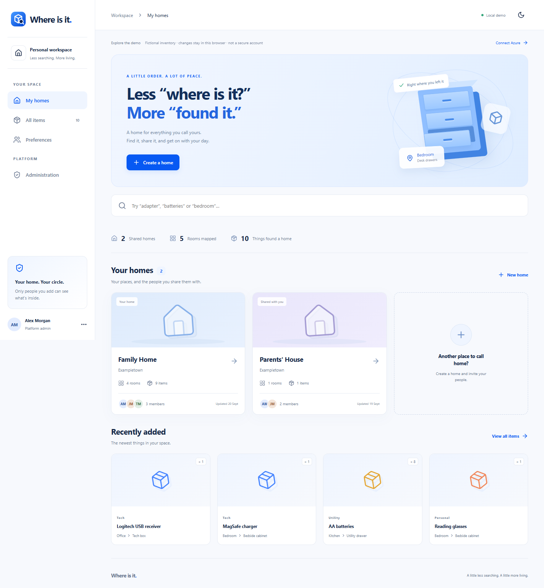
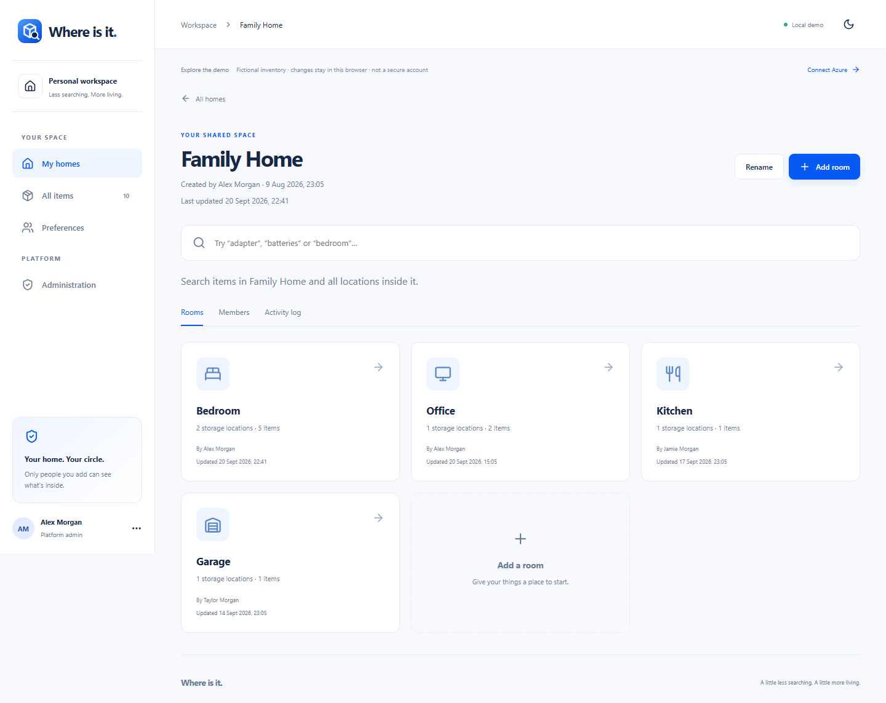
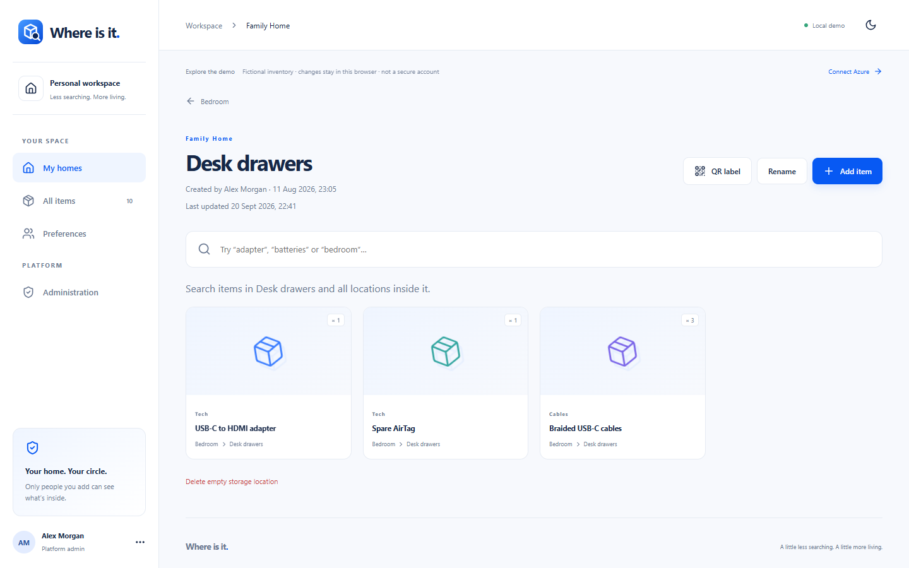
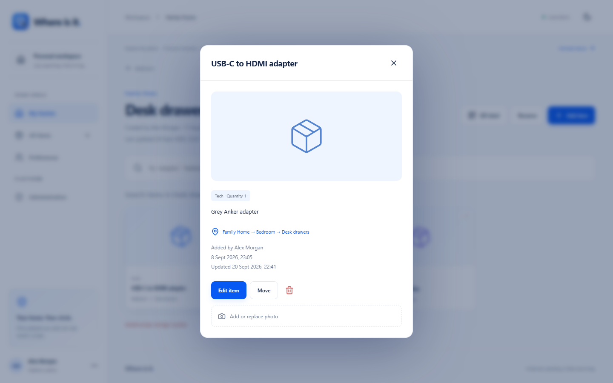
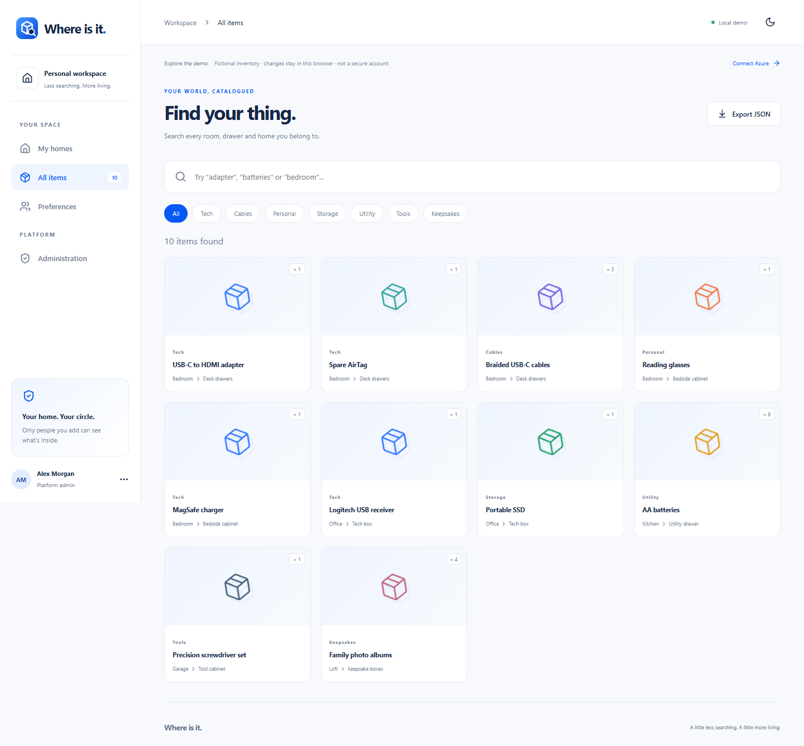
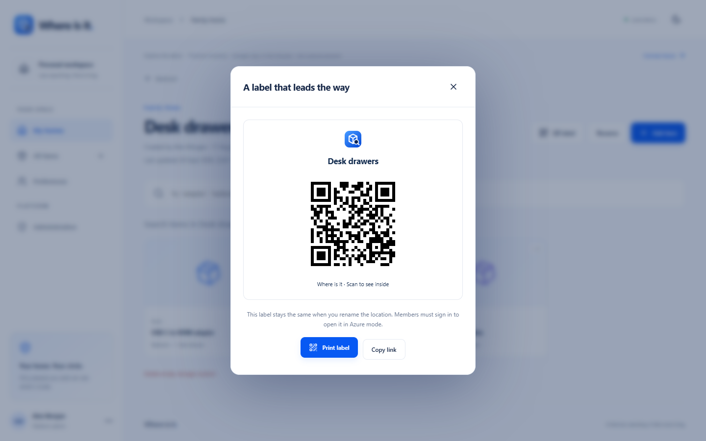
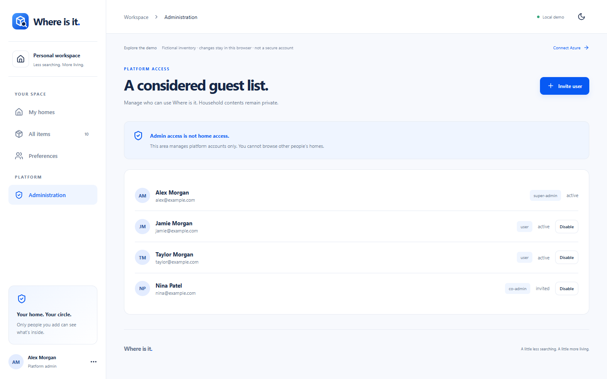
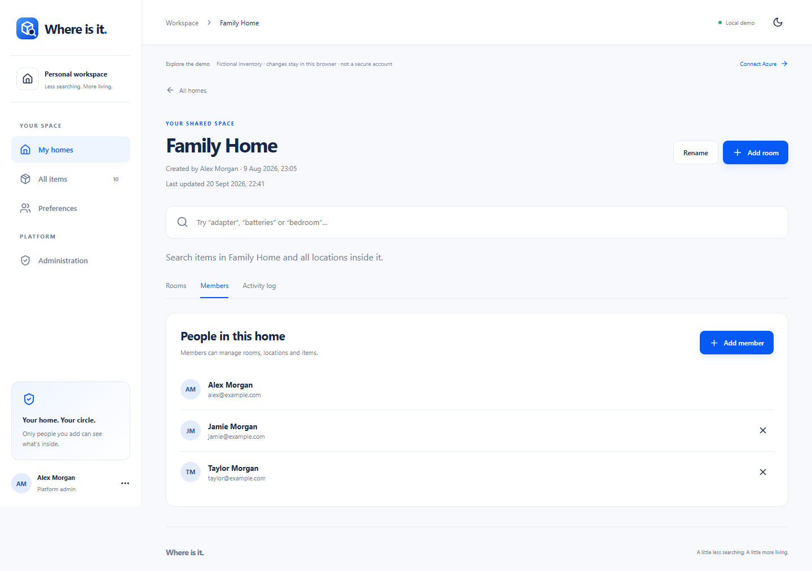
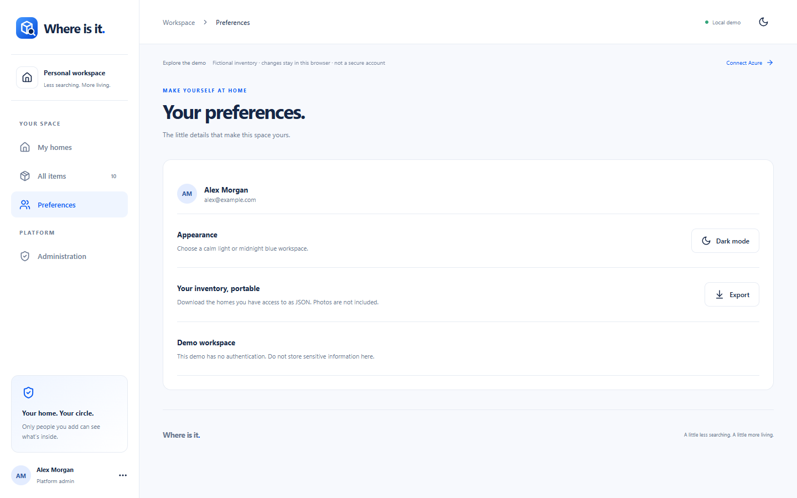

# Use Where Is It

These screenshots show the local demo with fictional data. Your Azure deployment starts with no homes. Sign in with the approved Microsoft account and use the same controls.

## Navigation and the dashboard

The left menu has **My homes**, **All items**, and **Preferences**. Platform administrators also see **Administration**. On a phone, open the menu with the top-left button. The top-right moon or sun button changes the theme. The dashboard shows all homes you belong to, counts, recently added items, and a search box that searches across homes.

## Build your first inventory

The path is **home → room → storage location → item**. For example: *Family Home → Bedroom → Desk drawers → USB-C to HDMI adapter*.

1. On **My homes**, select **Create a home**. Enter a name such as `Family Home` and optionally an area or description. Select **Save**. You own homes you create.
2. Open that home. Select **Add room**, enter `Bedroom`, choose a room style icon, and **Save**.
3. Open **Bedroom**. Select **Add storage**, enter `Desk drawers`, and **Save**. A storage location can be a drawer, shelf, box, cabinet, or another place you name.
4. Open **Desk drawers**. Select **Add item**, enter a name, quantity (1–9,999), category, and optional notes. Save it.

Use **Rename** in the heading of a home, room, or storage location to change its name. A room can be deleted only after all its locations are removed. A location can be deleted only when empty. To clear one, move or delete its items first.

## Manage items

Open an item card to see its category, quantity, notes, full location path, creator, and dates. Select **Edit item** to change name, quantity, category or notes. Select **Move** to choose another storage location in the **same home**. Select the trash icon to delete it; deletion is permanent in the app. The home's owner can see the event in **Activity log**.

After saving an item, open it and use **Add or replace photo**. Choose JPEG, PNG, or WebP. The browser compresses it to WebP; the API rejects a decoded photo above 650 KB. Each item has one photo. Azure photos are fetched only through the authenticated API after home membership is checked. Demo photos remain in that browser's local storage.

The search box matches item name, notes, category, home, room, and location. **All items** searches across homes you belong to and offers category chips. Search on a home or room page narrows to that space. Use the clear button to reset the query.

## QR labels

Open a storage location and select **QR label**, or use **Print label** on its card in the room. Print the label or copy its link. Stick it to the physical drawer or box. A phone camera can scan it and open that exact location. Renaming the location keeps its link stable. In Azure mode, a person must sign in and belong to the home to view it. A QR code is a link, not an access grant.

## Sharing and administration

There are two separate steps to share a home:

1. A **platform administrator** opens **Administration → Invite user**, enters a name, exact Microsoft sign-in email, and role, then sends the invitation. A super admin can also invite a co-admin. The invitee follows the email link, signs in with the matching Microsoft account, and selects **Accept invitation** within seven days. Resending to the same email replaces the earlier link. In local demo mode no email is sent.
2. The **home owner** opens the home, selects **Members → Add member**, and enters that active user's exact email. The owner can later remove them.

Platform administrators manage account approval and disabling. That role alone does **not** open other people's homes. Home members can manage rooms, locations and items, but cannot view the owner's Activity log or manage members. A disabled platform account cannot use the app.

In an Azure deployment, a super admin can select **Download admin change attempts** in Administration. The JSON contains the newest 500 platform audit intent records. Each is written before a change; it does not prove that the change finished.

## Activity, export and preferences

In a home you own, **Activity log** lists changes with an actor and time. Members do not see it. The UI shows up to the newest 500 entries per owned home; older entries can remain in Cosmos. It is an operational history, not a tamper-proof legal audit.

Open **All items → Export JSON** or **Preferences → Export** to download the homes visible to you. Photos are not included. There is no import or restore button, so keep your own backup if you rely on exports.

In **Preferences**, switch between light and dark mode and see the signed-in account. In Azure mode, use **Sign out** when done. In the demo, changes persist only in your browser. Demo mode is public and unauthenticated, so use fictional or non-sensitive data there.

For setup and operating limits, see [Azure deployment](AZURE_SETUP.md) and [Security](../SECURITY.md).
